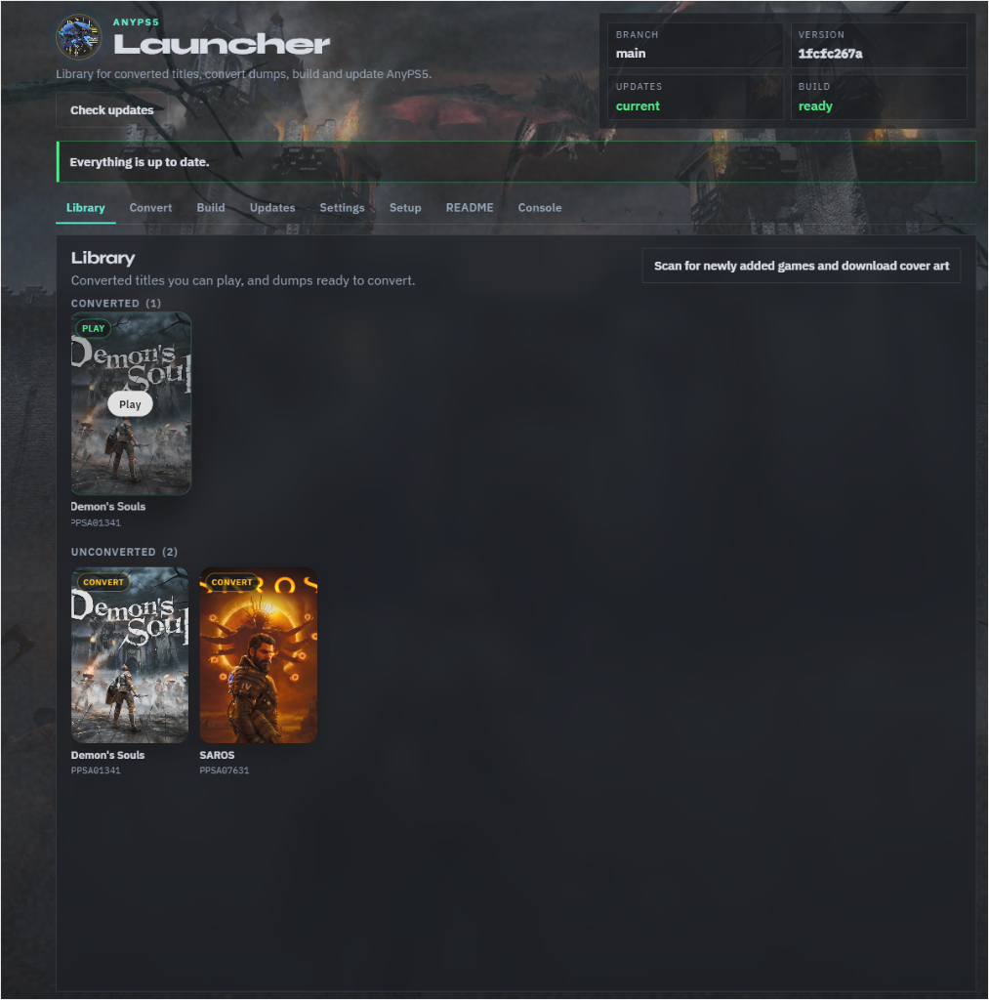
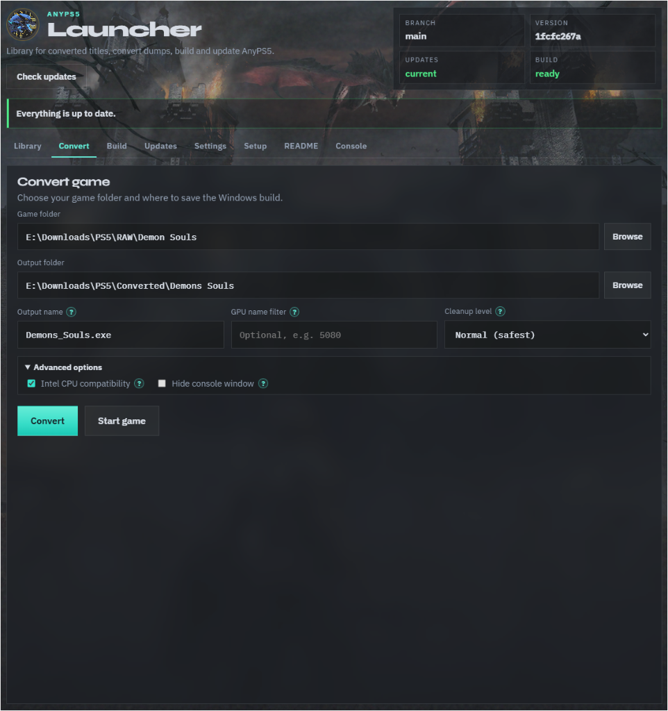
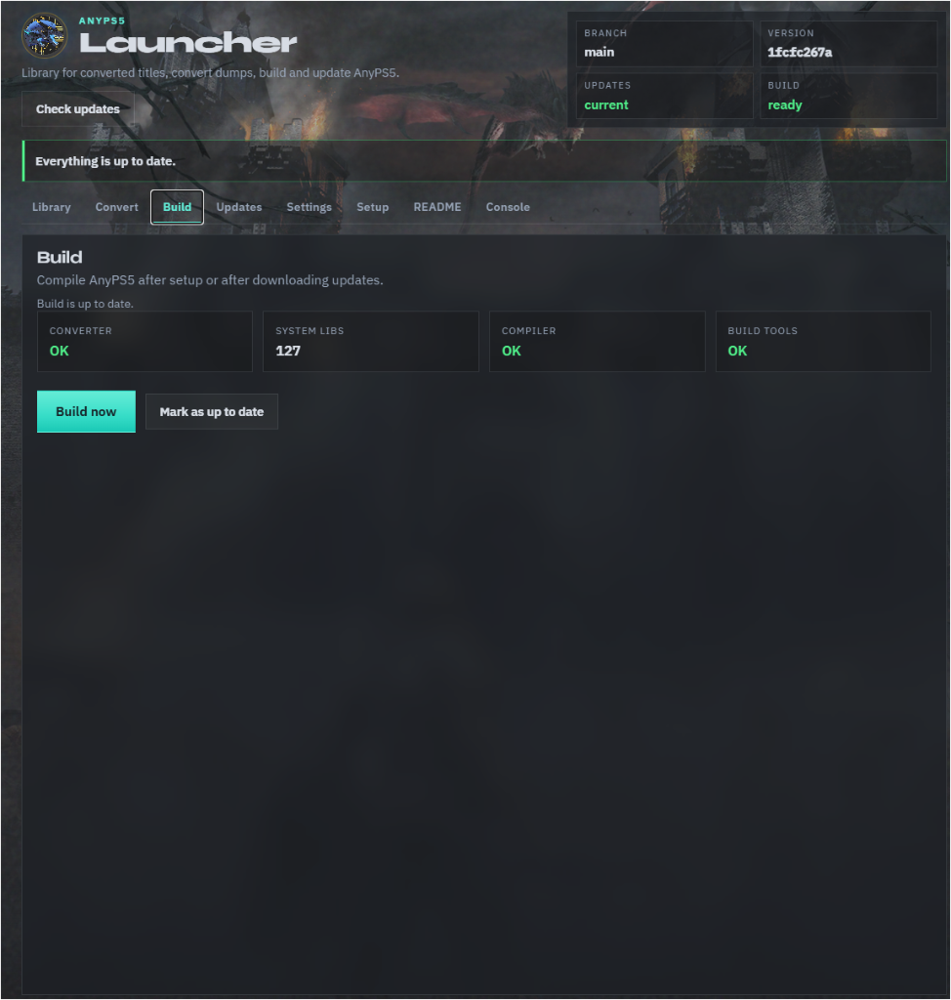
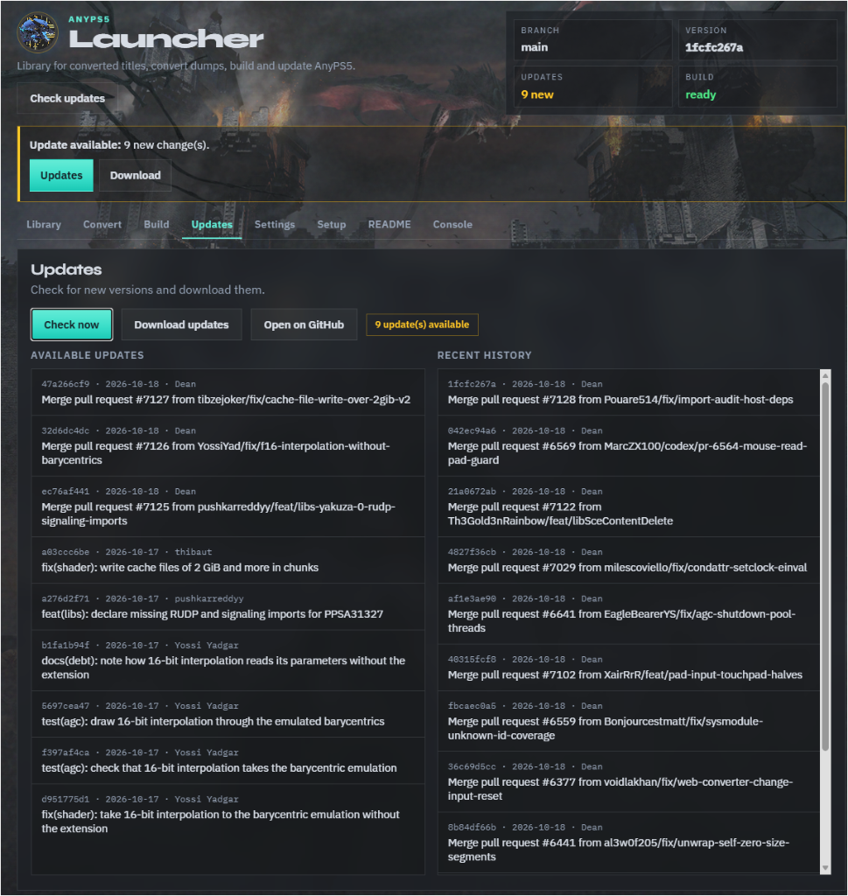
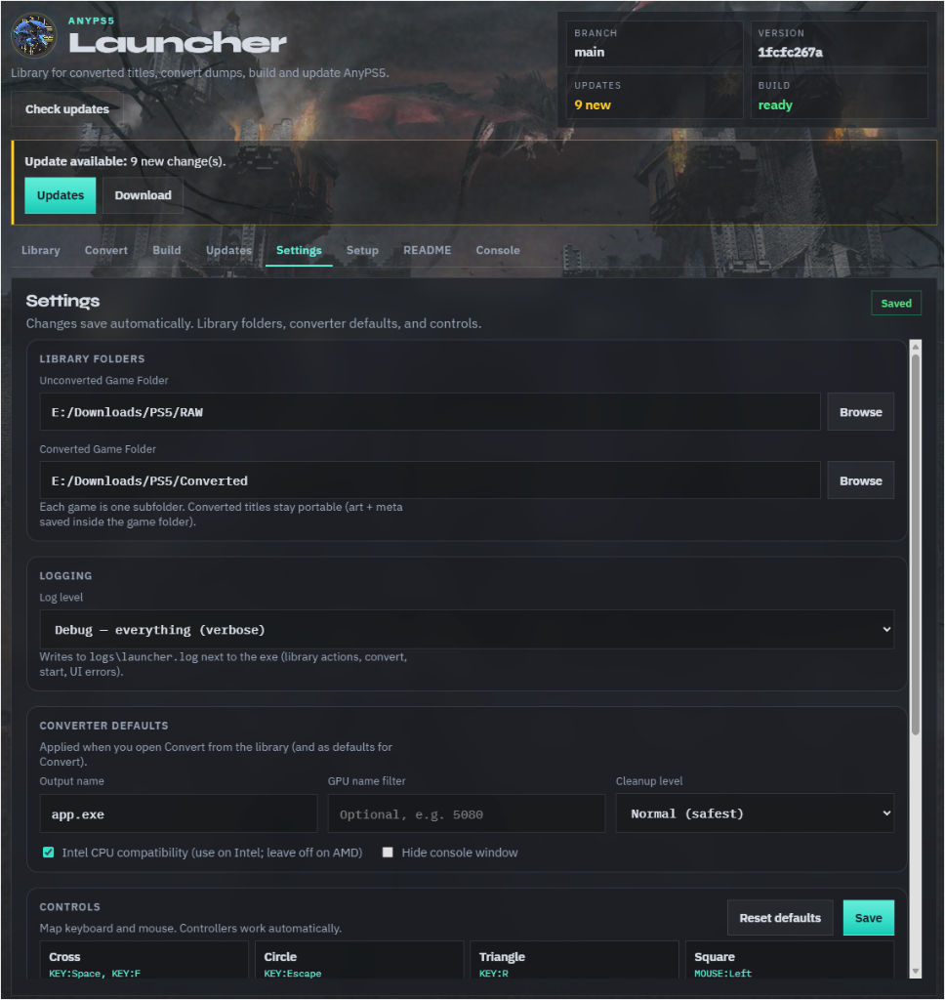
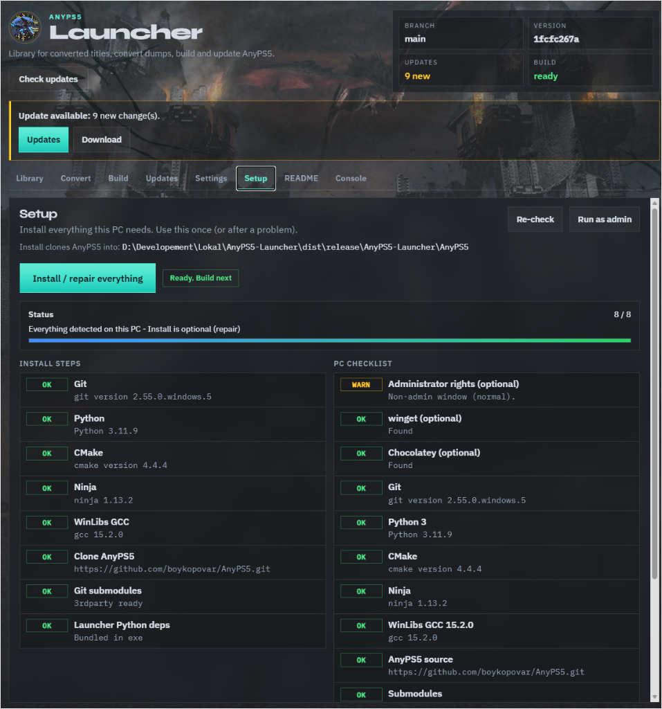
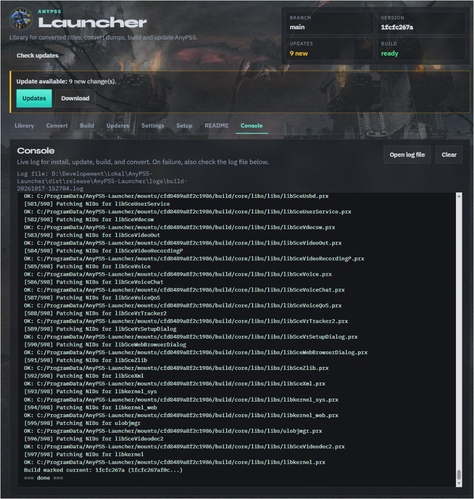
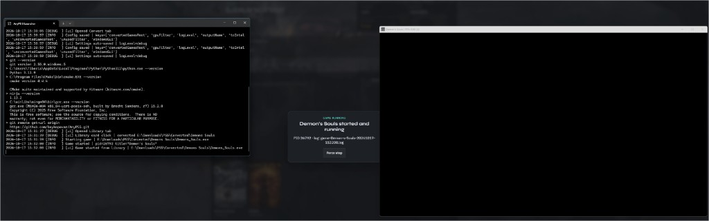

# AnyPS5 Launcher

Windows desktop launcher for **[AnyPS5](https://github.com/boykopovar/AnyPS5)**. Convert dumped PS5 game folders into a Windows `.exe` and run them locally.

This repo is the **launcher only**. It installs tools, clones AnyPS5 next to the app, builds the converter, manages a game library, converts titles, and starts them from a local UI.

**Current release:** [v1.4.0](https://github.com/Tiberius1OOO/AnyPS5-Launcher/releases/latest)

---

## Download

1. Get **AnyPS5-Launcher-windows.zip** from [Releases](https://github.com/Tiberius1OOO/AnyPS5-Launcher/releases/latest).
2. Unzip anywhere (spaces and deep paths are fine).
3. Run **`AnyPS5Launcher.exe`** (or `Start-AnyPS5.cmd`).

A console window opens and the UI loads at `http://127.0.0.1:8765/`. Leave that console open while you use the launcher.

---

## Recommended workflow

1. **Setup** → **Install / repair everything** (once)
2. **Build** → **Build now** (after first install or after pulling AnyPS5 updates)
3. **Settings** → set **Unconverted** and **Converted** game folders
4. **Library** → first-time scan (automatic once), then **Play** or **Convert**
5. Later: **Updates** → download AnyPS5 changes → **Build** again if needed

---

## Tabs

### Library



Your game shelf. Converted titles show a **Play** badge; dumps show **Convert**.

| Feature | What it does |
|---------|----------------|
| Cover grid | Local art from `anyps5-art/` (and online cover download when scanning) |
| Hover backdrop | Soft background art while you move across cards |
| Instant load | Saves `library-cache.json` so the next start is immediate (quick "still there?" check) |
| First time scan | Only when folders are set and nothing has been scanned yet |
| Scan button | **Scan for newly added games and download cover art**. Adds new folders only; skips games that already have covers |
| Folder sizes | Totals next to Converted / Unconverted after sizes are known |

Click a converted card to **Play** (locks the UI while the game runs). Click an unconverted card to jump to **Convert** with paths prefilled.

---

### Convert



Turn a dump into a Windows build.

| Field | Purpose |
|-------|---------|
| Game folder | Decrypted PS5 dump (`eboot.bin` / `.elf`, modules, `sce_sys`, etc.) |
| Output folder | Usually `ConvertedRoot\GameName` (created from Library) |
| Output name | `.exe` name (e.g. `Demons_Souls.exe`) |
| GPU name filter | Optional substring so the title picks a specific GPU |
| Cleanup level | Normal (safest) → Stronger → Strict |
| Intel CPU compatibility | On for Intel hosts; leave off on AMD |
| Hide console window | Convert-time Windows GUI subsystem for the `.exe` |
| Convert / Start game | Run the relinker packaging steps, or launch the last output |

---

### Build



Compile AnyPS5 (converter + system libs) after Setup or after Updates.

- Status cards: Converter, System libs, Compiler, Build tools
- **Build now**: full CMake / Ninja rebuild
- **Mark as up to date**: if you built outside the launcher

Header chips show whether the build matches the current AnyPS5 commit.

---

### Updates



Pull new AnyPS5 commits from GitHub.

- **Check now**: fetch pending changes
- **Download updates**: git pull into `<launcher>\AnyPS5`
- Lists of available updates and recent history
- After a pull, run **Build** again when the banner says the build is outdated

---

### Settings



| Section | Contents |
|---------|----------|
| Library folders | Unconverted + Converted roots (required for Library) |
| Logging | Log level → `logs\launcher.log` |
| Converter defaults | Output name, GPU filter, cleanup, Intel, convert GUI flag |
| Hide game console when playing | **Off by default**. Shows a separate console with live game output. Turn on to hide it (output goes to `logs\game-*.log`) |
| Controls | Keyboard / mouse remapping (controllers work automatically) |

Settings autosave when you change values.

---

### Setup



One-time (or repair) environment install.

- Progress bar and install steps (Git, Python, CMake, Ninja, WinLibs GCC, clone AnyPS5, submodules, etc.)
- PC checklist
- **Install / repair everything**, **Re-check**, **Run as admin** when a tool needs elevation

AnyPS5 is always cloned to `<launcher-folder>\AnyPS5`.

---

### README (in-app)

Shows the live upstream AnyPS5 readme from GitHub (Reload / Open on GitHub). This file is the **launcher** documentation.

---

### Console



Live log for Setup, Updates, Build, and Convert.

- **Open log file**: current job log under `logs\`
- **Clear**: clear the on-screen view
- Per-game convert logs: `logs\convert-<game>-<timestamp>.log`

---

## Playing a game



1. Open **Library** → click a converted title.
2. A lock overlay appears with a spinner while runtimes are prepared (**Starting...**), then shows the PID when the process is up.
3. By default a **separate game console** shows init / compile output. Hide it in **Settings** if you prefer.
4. Close the game (or **Force stop**) to unlock the launcher. Only one game can run at a time.

---

## Convert details

### What the game folder needs

- Entry binary such as `eboot.bin` or another `.elf`
- Modules (`sce_module` / `sce_modules`, and engine folders like Unity `Media/Modules`)
- Usual dump layout (`sce_sys`, title content, etc.)

### What Convert does

- Runs the AnyPS5 relinker with your options
- Passes extra `--module-dir` paths when needed
- Copies system `.prx` libs and MinGW runtime DLLs next to the `.exe` / under `libs` and `app0`
- Copies title resources into `app0/`
- **Start game** re-checks MinGW DLLs if an older convert is missing them

---

## Troubleshooting

| Symptom | What to try |
|---------|-------------|
| Setup / Build fails | **Console** + `logs\last-job.log` |
| Convert / start error **126** | Re-run Convert or Start so MinGW DLLs are packaged |
| Game lock stuck on Starting | Wait for MinGW copy; watch the game console (Settings → hide console off) |
| Library empty after move | Set folders in Settings; press Scan for newly added games |
| Relinker: `Skipping SELF container` | Unwrap modules with AnyPS5 `tools/unwrap_self.py` before Convert |
| Launcher Update Now on very old builds | Install the latest zip once by hand |

---

## Build from source (developers)

```bat
pip install -r requirements.txt
python app\app.py
```

Release zip:

```bat
powershell -ExecutionPolicy Bypass -File scripts\build-release.ps1
```

Output: `dist\release\AnyPS5-Launcher\` and `AnyPS5-Launcher-windows.zip`.

---

## Changelog (launcher)

### v1.4.0

- Documented README with screenshots for each main tab
- Library cache: instant load, first-time scan only once, incremental Scan button
- Play lock: spinner + "Starting..." while the process is prepared; PID when running
- Settings: **Hide game console when playing** (default off, console visible)
- Single-instance game launch; game logs under `logs\game-*.log` when console is hidden

### v1.3.x

- Library tab, portable art/meta, Settings folders, convert chime, cover download

---

## License

MIT. See [LICENSE](LICENSE).

AnyPS5 remains under its own terms: [boykopovar/AnyPS5](https://github.com/boykopovar/AnyPS5).
